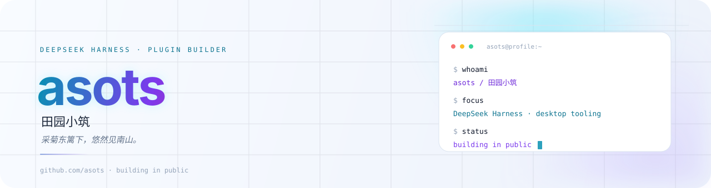

<picture>
  <source media="(prefers-color-scheme: dark)" srcset="assets/hero-dark.svg">
  
</picture>

 

## 现在 / Now

做安静、够快的桌面端 AI 工具。把复杂的部分留在实现里，把简单留给用的人。

- 正在打磨 **[dsh-longsession](https://github.com/asots/dsh-longsession)**：让 DeepSeek Harness 的长会话不再越用越卡。
- 正在整理 **[tav-workflow](https://github.com/asots/tav-workflow)**：让 agent 的改动有证据、有验证。
- 探索 DeepSeek Harness 插件、agent skills 和桌面端交互。

## 作品 / Selected work

  
  

> `dsh-longsession` 是我目前主要的公开项目：用宿主自己的 `SessionFace.resync()` 卸载已渲染的历史，把长会话的页面窗口从不断膨胀变成可收起、可还原。

## DeepSeek Harness 插件

把长会话的性能问题做成一个可逆的开关，也把插件体验做细：状态、反馈、设置页、浅色/深色、可访问性。

- **[dsh-longsession](https://github.com/asots/dsh-longsession)** — `JavaScript` · 可逆「收起历史」· 20 个长会话压力测试 · market entry
- **[dsh-claude-style](https://github.com/asots/dsh-claude-style)** — `fork` · 给 DSH 的 Claude Code Desktop 主题
- **[dsh-free-search](https://github.com/asots/dsh-free-search)** — `fork` · 无 API key 的免费搜索 provider
- **[dsh-purge](https://github.com/asots/dsh-purge)** — `fork` · DSH prompt/jailbreak 实验

> 标了 `fork` 的是我用来学习和做实验的上游项目，不是我的原创作品。

## 工具箱 / Toolbox

  

  
  
  
  
  

## 关于 / About

<table>
  <tr>
    <td width="58%" valign="top">
      
长期关注桌面端 AI 工具的<strong>性能、交互与可维护性</strong>。

      
喜欢把真实问题拆开量一量，再决定要不要动代码。长会话插件就是这么来的：不是“加个动画”，而是把已加载窗口真正收回去。

      
<a href="https://github.com/asots?tab=repositories">所有仓库</a> · <a href="https://github.com/asots/dsh-longsession/issues">提 issue</a>

    </td>
    <td width="42%" valign="top">
      <blockquote>
        
采菊东篱下， 悠然见南山。

        
保持好奇，慢慢打磨。

      </blockquote>
    </td>
  </tr>
</table>

  Keep it calm, keep it fast. · 2026

